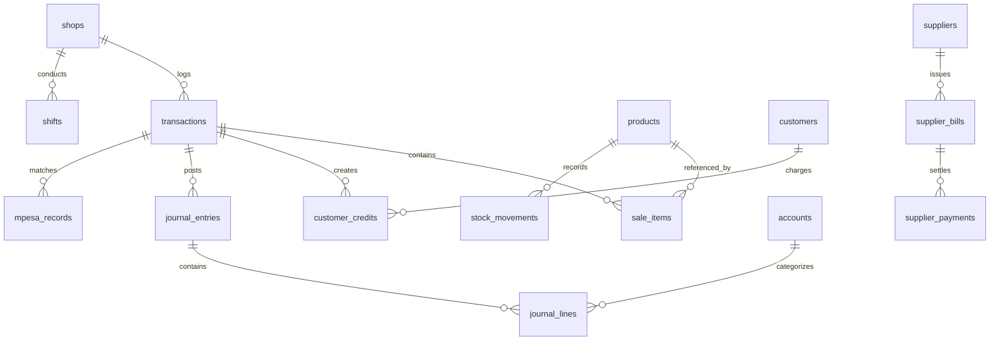

# DukaSauti — System Architecture and Technical Design

## 1. Architectural Overview and System Topology

DukaSauti is structured as an offline-first, single-operator desktop workstation engineered for local execution on Linux environments. The system topology separates presentation, business logic execution, data persistence, and on-device machine intelligence into distinct layers communicating over local loopback boundaries.

```
+-------------------------------------------------------------------+
|                        Linux Desktop Host                         |
|                                                                   |
|  +-------------------------------------------------------------+  |
|  |                 Electron Presentation Layer                 |  |
|  |  +-----------------------+     +-------------------------+  |  |
|  |  |  HTML5 / Vanilla JS   |     |  Hardware Integrations  |  |  |
|  |  |  Single Page App UI   |     |  (Barcodes, Thermal,    |  |  |
|  |  |  (Offline Assets)     |     |   Microphone Speech)    |  |  |
|  |  +-----------------------+     +-------------------------+  |  |
|  +------------------------------|------------------------------+  |
|                                 | Loopback HTTP (127.0.0.1)       |
|  +------------------------------v------------------------------+  |
|  |                  Node.js Application Server                 |  |
|  |  +-------------------------------------------------------+  |  |
|  |  |  REST API Routing & Request Handling (src/server.js)  |  |  |
|  |  +-------------------------------------------------------+  |  |
|  |  |  Domain Logic & Financial Invariants (src/domain.js)  |  |  |
|  |  +-------------------------------------------------------+  |  |
|  |  |  Business Operations Engine (src/business.js)         |  |  |
|  |  +-------------------------------------------------------+  |  |
|  |  |  Local QVAC Inference Adapter (src/qvac.js)           |  |  |
|  |  +-------------------------------------------------------+  |  |
|  +------------------------------|------------------------------+  |
|                                 | Native In-Process IPC           |
|  +------------------------------v------------------------------+  |
|  |                   SQLite Persistence Layer                  |  |
|  |  +-------------------------------------------------------+  |  |
|  |  |  node:sqlite DatabaseSync (WAL Mode, Foreign Keys)     |  |  |
|  |  |  Versioned Schema Migrations Pipeline (src/db.js)      |  |  |
|  |  +-------------------------------------------------------+  |  |
|  +-------------------------------------------------------------+  |
+-------------------------------------------------------------------+
```

---

## 2. Component Boundaries and Responsibilities

### 2.1 Electron Desktop Shell
* Provides a native windowing wrapper for Linux desktop workstations.
* Enforces strict context isolation (`contextIsolation: true`) and disables Node.js integration in renderer frames (`nodeIntegration: false`).
* Restricts navigation exclusively to the local loopback origin (`http://127.0.0.1:3000`).

### 2.2 Presentation Layer (Single Page Application)
* Built without external runtime frameworks, bundlers, or remote CDN dependencies (zero external scripts, stylesheets, or remote web fonts).
* State management uses pure reactive JavaScript patterns with immediate DOM updates.
* Provides full bilingual support through a comprehensive in-memory translation dictionary (`I18N`) supporting English and Kiswahili.

### 2.3 Application and Business Operations Layer
* Built with Node.js v22 LTS leveraging modern ES Modules (`import`/`export`).
* Enforces financial invariants, such as integer minor-unit calculations and credit threshold verification.
* Coordinates compound operations inside database transactions:
  * POS checkout decrementing stock, posting accounts receivable, and creating balanced double-entry journal records.
  * Shift float tracking and physical cash reconciliation.
  * Safaricom M-Pesa SMS and statement parsing.

### 2.4 Persistence Layer (SQLite Engine)
* Powered by native `node:sqlite` `DatabaseSync`, eliminating external native C++ compilation steps during deployment.
* Configured with Write-Ahead Logging (`PRAGMA journal_mode = WAL;`) for high concurrency and crash durability.
* Enforces foreign key constraints (`PRAGMA foreign_keys = ON;`) and sets a 5000ms busy timeout (`PRAGMA busy_timeout = 5000;`) to prevent lock contention.

---

## 3. Relational Database Schema and Data Models

Database schema evolution is managed through an ordered, version-tracked migration pipeline recorded in the `schema_migrations` table.



### Table Specifications:

* `shops`: Stores business identity, operational currency (KES), default timezone (Africa/Nairobi), and default opening cash float in minor units.
* `transactions`: Core transactional records tracking business date, transaction type (sale, expense, debt repayment, restock), description, total amount in minor units, split payment details (cash, mpesa, bank, credit), status (confirmed, draft, reversed), and operator notes.
* `products`: Retail product catalog holding SKU/barcode, item name, category, unit of measure, active stock quantity, cost price minor units, selling price minor units, and low-stock reorder thresholds.
* `sale_items`: Line-item breakdown of completed POS sales containing product ID, product name, quantity sold, unit price minor units, unit cost minor units, and line total minor units.
* `stock_movements`: Immutable inventory audit trail recording movement type (sale, restock, adjustment, unpack), quantity delta, resulting stock, and associated transaction ID.
* `customers`: Customer credit registry containing personal details, telephone, credit limit in minor units, and outstanding debt balance in minor units.
* `customer_credits`: Ledger tracking customer charges and credit repayments tied to specific transactions.
* `suppliers`: Supplier directory tracking contact information, company names, and outstanding payables.
* `supplier_bills`: Inbound inventory and expense invoices tracking total bill amount, paid amount, due date, status (unpaid, partial, paid), and restock associations.
* `supplier_payments`: Cash, M-Pesa, or Bank disbursements applied against open supplier bills.
* `mpesa_records`: Safaricom mobile money statement records holding M-Pesa reference code, timestamp, transaction direction, amount in minor units, party name, phone number, and matched transaction reference.
* `accounts`: Double-entry Chart of Accounts (Cash, M-Pesa, Bank, Receivables, Inventory, Payables, Equity, Sales, COGS, Overheads).
* `journal_entries`: Double-entry transaction headers storing reference code, date, description, and audit pointers.
* `journal_lines`: Balancing debit and credit lines linked to specific accounts.
* `shifts`: Cash drawer shift records holding date, opening float, cash sales, cash repayments, cash expenses, cash disbursements, counted cash, variance, and notes.
* `audit_log`: Append-only security and data modification trail recording actor, entity, entity ID, action, and JSON payload diffs.
* `staff_users`: Staff authentication table holding username, 4-digit PIN hash (SHA-256), and role assignment (owner or cashier).
* `schema_migrations`: Version tracking table ensuring migrations are applied sequentially and idempotently.

---

## 4. Double-Entry Accounting State Engine

The platform enforces strict double-entry balance on all financial events. The following matrix illustrates the automated debit and credit postings:

| Operational Event | Debited Account(s) | Credited Account(s) |
| :--- | :--- | :--- |
| **POS Cash Sale** | 1000 Cash on Hand | 4000 Sales Revenue |
| **POS M-Pesa Sale** | 1010 M-Pesa Account | 4000 Sales Revenue |
| **POS Bank Sale** | 1020 Bank Account | 4000 Sales Revenue |
| **POS Credit Sale (Deni)** | 1100 Accounts Receivable | 4000 Sales Revenue |
| **COGS Recognition (on Sale)** | 5000 Cost of Goods Sold | 1200 Inventory Asset |
| **Operational Expense (Cash)** | 6000-6090 Expense Accounts | 1000 Cash on Hand |
| **Operational Expense (M-Pesa)** | 6000-6090 Expense Accounts | 1010 M-Pesa Account |
| **Supplier Bill (Inventory Restock)** | 1200 Inventory Asset | 2000 Accounts Payable |
| **Supplier Bill Payment (Cash)** | 2000 Accounts Payable | 1000 Cash on Hand |
| **Supplier Bill Payment (M-Pesa)**| 2000 Accounts Payable | 1010 M-Pesa Account |
| **Customer Debt Repayment (Cash)** | 1000 Cash on Hand | 1100 Accounts Receivable |
| **Customer Debt Repayment (M-Pesa)**| 1010 M-Pesa Account | 1100 Accounts Receivable |

### Journal Balance Invariant
Every transaction must satisfy the following invariant before commit:
```
Sum of Debits == Sum of Credits
```
If an imbalance of even 1 minor unit occurs, the transaction is rejected and rolled back immediately.

---

## 5. Security Architecture and Cryptography

### 5.1 Local Network Isolation
* The backend HTTP service binds exclusively to loopback interface `127.0.0.1`.
* It ignores remote network connection attempts, protecting financial and customer data from local network probing.

### 5.2 PIN Cryptography
* User access PINs are never stored in plaintext.
* Standard 4-digit PINs are transformed into cryptographic hashes using `crypto.createHash('sha256').update(pin).digest('hex')`.
* PIN comparison uses constant-time string comparison to resist timing analysis.

### 5.3 Encrypted Backup Pipeline (AES-256-GCM)
Encrypted backups protect commercial records when transferred to external flash drives or backup media:
* **Key Derivation:** The user's backup passphrase is processed with `crypto.scryptSync(passphrase, salt, 32)` using a cryptographically random 16-byte salt.
* **Cipher Mode:** Data is encrypted using AES-256-GCM (Galois/Counter Mode), producing ciphertext, a 12-byte initialization vector (IV), and a 16-byte authentication tag.
* **Integrity Guarantee:** Any alteration to the encrypted backup file invalidates the authentication tag, causing restoration to abort cleanly without corrupting the operational database.

---

## 6. Hardware Integration Protocols

### 6.1 Hardware Barcode Scanner Buffer
* Barcode scanners operating in USB HID Keyboard Emulation mode send keystrokes in rapid succession (typically under 20ms per character), followed by an `Enter` key.
* The frontend implements a time-windowed listener:
  1. Keystrokes arriving with inter-key intervals under 150ms are captured into a dedicated barcode buffer.
  2. If the sequence terminates with `Enter` and exceeds 3 characters, the event is intercepted, preventing normal focus triggering.
  3. The buffered barcode is queried against the product catalog, automatically incrementing the product in the active POS cart.

### 6.2 Thermal Monospace Printing Engine
* Thermal receipt printing formats character streams for standard 58mm (32 characters wide) and 80mm (48 characters wide) paper rolls.
* Receipts are generated with fixed-width typography, column padding algorithms, and dedicated CSS `@media print` stylesheets that hide desktop UI chrome.
